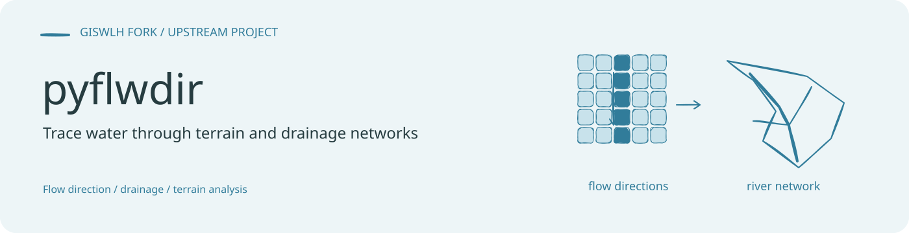

# PyFlwDir

面向数字高程模型与栅格流向数据的 Python 工具库，提供河网提取、流域划分、汇流累积、地形指标和流向尺度转换等方法，并使用 Numba 加速计算。

此仓库基于 [Deltares/PyFlwDir](https://github.com/Deltares/pyflwdir)。本页为中文入口，原始 [README.rst](README.rst)、作者信息与许可证继续保留。

## 功能与示例图


上图来自仓库已有文档资源，展示高程、Strahler 河流等级、IHU 流向升尺度、出口流域、Pfafstetter 子流域、经典河流等级、HAND、地貌洪泛区与流路追踪。它是上游示例成果，未作为本次重新运行的结果。

## 安装与开始使用

当前仓库的 `pyproject.toml` 声明 Python ≥ 3.8，核心依赖包括 affine、Numba、NumPy 和 SciPy。安装当前检出的源码：

```bash
python -m pip install .
```

读取 GeoTIFF 和处理空间矢量的完整示例还会用到 rasterio、GeoPandas 等地理空间依赖，参见 [环境配置](environment.yml)。

建议从以下 Notebook 开始，示例目录包含莱茵河流域的高程和 D8 流向栅格：

| 目标 | 示例 |
| --- | --- |
| 从高程推导流向 | [from_dem.ipynb](examples/from_dem.ipynb) |
| 读取与处理流向 | [flwdir.ipynb](examples/flwdir.ipynb) |
| 划分流域 | [basins.ipynb](examples/basins.ipynb) |
| 河网与河流等级 | [streams.ipynb](examples/streams.ipynb) |
| 沿流向追踪 | [tracing.ipynb](examples/tracing.ipynb) |
| 计算地形指标 | [elevation_indices.ipynb](examples/elevation_indices.ipynb) |
| 流向升尺度 | [upscaling.ipynb](examples/upscaling.ipynb) |

## 文档与开发

- [快速入门](docs/quickstart.rst)
- [API 参考入口](docs/reference.rst)
- [贡献指南](CONTRIBUTING.rst)
- [更新记录](CHANGELOG.rst)
- [作者信息](AUTHORS.txt)与 [MIT License](LICENSE)

测试代码位于 `tests/`。开发环境与可选依赖见 `envs/` 和 `pyproject.toml`。

本仓库首页横幅的可编辑源文件：[banner.excalidraw](assets/readme/banner.excalidraw)。
